# Памятка к защите «ХРОНОЛИФТ»

Для того, кто идёт защищать. Читается за 10 минут, ничего заранее знать о проекте не нужно.

- Защита — показ на 2–3 минуты и вопросы. Баллы ставят всей команде, кто именно защищает, неважно.
- Ближайший блок — **«удержание игроков», 10 баллов**. Ниже по шагам, что показать под каждый пункт.
- Скриншоты в этом файле — из текущей версии игры. Переснять: `node test/shots_defense.js`.

## 1. Подготовка (за 5 минут до пары)

1. **Без интернета (рекомендуется на паре):** скачать репозиторий заранее, дома
   (https://github.com/nelex12/chronolift → ветка `fixes-and-defense` → Code → Download ZIP),
   распаковать и открыть двойным щелчком **`chronolift-offline.html`**. Это вся игра в одном файле:
   интернет и установка не нужны. Открывать в Chrome, Edge или Яндекс Браузере.
   Это та же игра с имитацией Яндекс Игр: вход, облачные сохранения, лидерборд, покупки и реклама
   работают как на платформе.
2. **Если интернет есть:** **https://nelex12.github.io/chronolift/game/test-yandex.html** — то же
   самое онлайн, работает и с телефона. Музыка по сети догружается несколько секунд.
3. Чтобы показ начинался «с нуля» (с приветствия и ежедневной награды), открыть страницу
   в окне инкогнито. Если игра уже открывалась: «Настройки» → «Сбросить прогресс» → нажать ещё раз.
4. На ноутбуке окно браузера сделать узким, как телефон (или F12 → значок телефона): игра вертикальная.

Управление: **зажать** мышь, экран или пробел — время останавливается, ловушки замирают.
Отпустить — время идёт дальше. Энергия на остановку времени тратится и восстанавливается
сама (полоса слева вверху). **Красная** зона убивает сейчас, **жёлтая мигающая** станет красной
через секунду — в этот момент и надо зажимать.

## 2. Сценарий показа на 2–3 минуты

**Фраза для начала:** «Аркада про лифт: он едет вверх через этажи с ловушками. Зажимаешь
экран — время останавливается, и ты проскальзываешь мимо. Сессия 1–2 минуты, жанр — казуальная
аркада, платформа — Яндекс Игры».

| # | Что делаем | Что говорим | Пункт рубрики |
|---|---|---|---|
| 1 | Открываем игру: приветствие, затем всплывает ежедневная награда | «Сразу при входе — ежедневная награда, видна серия дней. Чем длиннее серия, тем больше награда: 7 дней, от 25 до 300 монет» | Daily Reward (2) |
| 2 | Забираем награду, показываем меню: на кнопке «Миссии» красный значок | «Значок появляется, только когда есть невыбранная награда» | UI/UX (1) |
| 3 | «Миссии»: три карточки с прогрессом и кнопкой «Забрать» | «Каждый день три новые миссии из одиннадцати, у всех разные цели. Сброс в полночь по времени игрока, таймер показан сверху» | Daily Missions (2) |
| 4 | «Играть», проходим пару этажей | «Прогресс миссий считается прямо в игре: этажи, остановки времени, комбо, монеты. Выполнил — сразу всплывает сообщение» | Интеграция с геймплеем (1) |
| 5 | После проигрыша — экран итогов с блоками «Достижения» и «Миссии» | «Экран итогов напоминает забрать награду в меню» | Интеграция (1), UI/UX (1) |
| 6 | «Достижения»: 7 карточек с прогрессом | «Семь достижений: часть за мастерство, часть за коллекцию. Награда — монеты, они тратятся на возрождение» | Achievements (2) |
| 7 | Перезагружаем страницу (F5) | «Прогресс сохраняется на устройстве и в облаке Яндекса; при входе с другого устройства берётся более свежая версия» | Сохранение состояния (1) |
| 8 | Одна фраза в конце | «Почему это удерживает: незавершённые миссии хочется закрыть, серию дней жалко терять, каждый день новые цели. Подробное обоснование по каждому пункту — в `docs/RETENTION.md`» | Обоснование (1) |

Если осталось время: лидерборд (кубок слева вверху), магазин, скины, настройки. Звук лучше включить:
у жёлтой зоны есть сигналы, которые громче по мере приближения, и фоновая музыка.

### Что будет на экране

| Ежедневная награда | Меню, значок на «Миссиях» | Миссии дня |
|---|---|---|
| 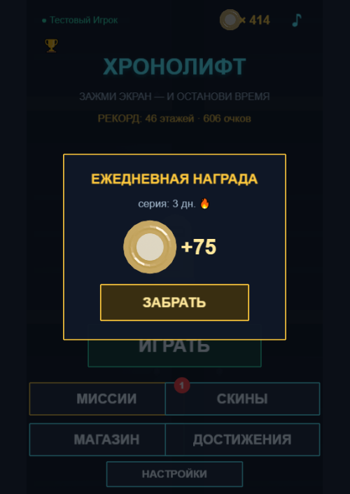 | 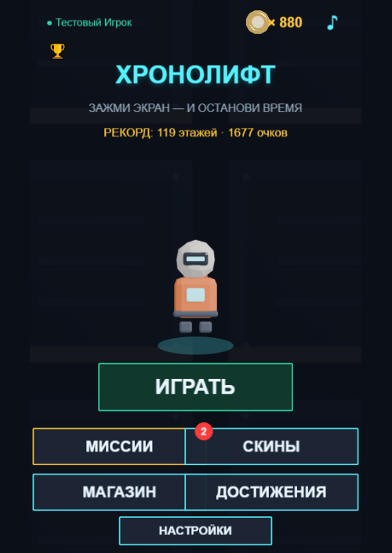 | 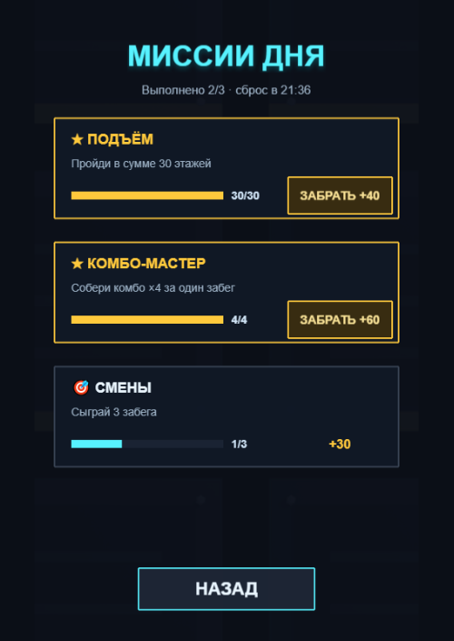 |

| Миссия выполнена прямо в забеге | Экран итогов | Достижения |
|---|---|---|
| 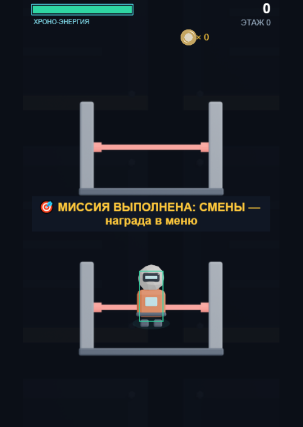 | 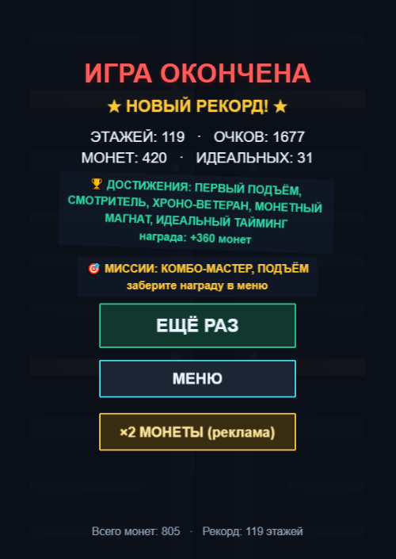 | 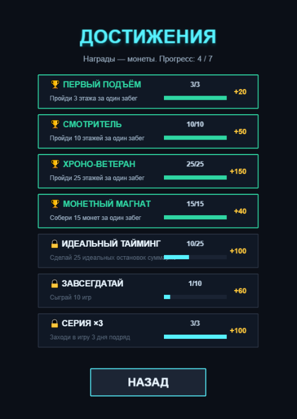 |

| Приветствие при первом входе | Обучение: первый этаж | Лидерборд |
|---|---|---|
| 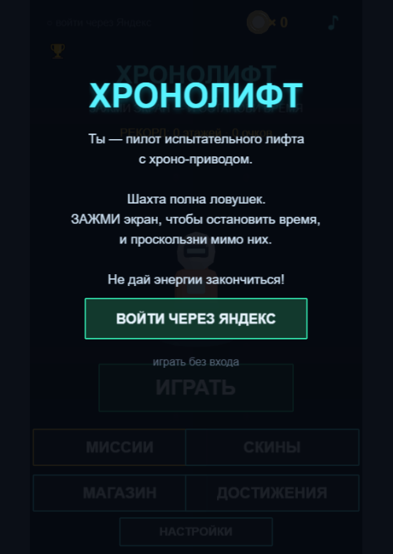 | 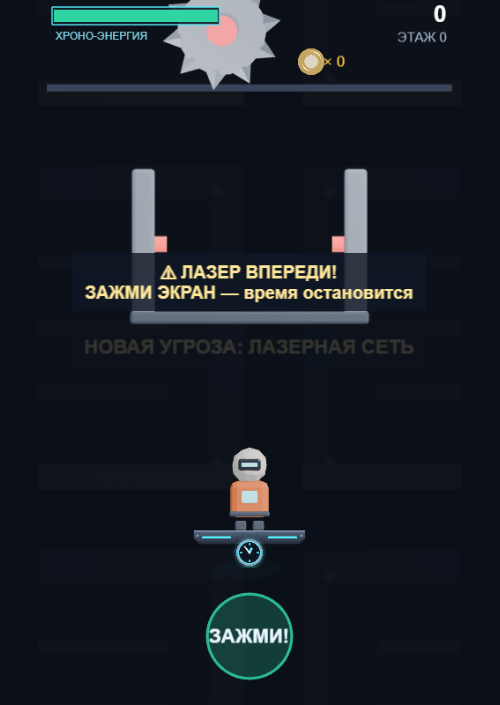 | 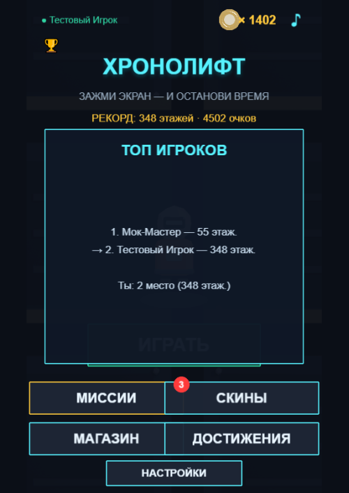 |

| Скины | Магазин | Настройки |
|---|---|---|
| 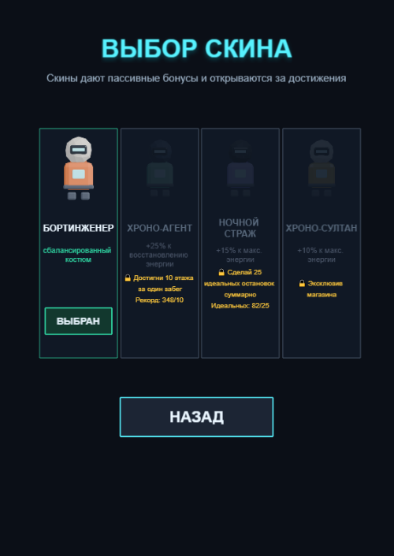 | 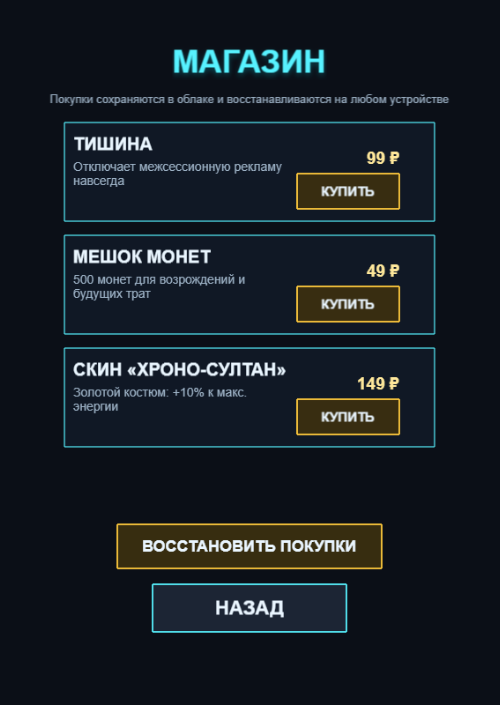 | 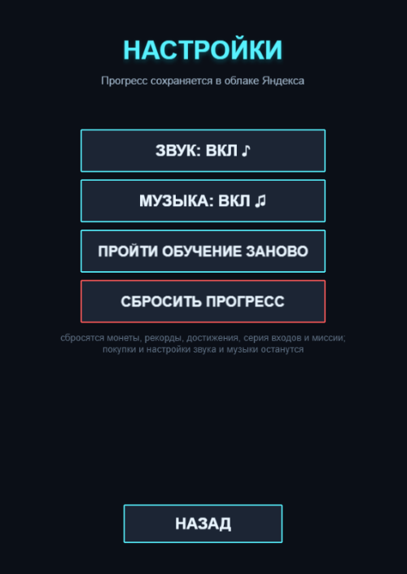 |

## 3. Рубрика «удержание»: где что лежит

| Критерий | Баллы | Где в игре | Код |
|---|---|---|---|
| Daily Reward | 2 | всплывает при входе, раз в день | `Services/DailyService.js`, награды — `DAILY_REWARDS` в `Core/Config.js` |
| Daily Missions | 2 | меню → «Миссии»; минимум курса — 3 миссии, у нас 3 в день из 11 | `Services/MissionService.js`, `UI/MissionsScene.js`, пул — `MISSIONS` в `Core/Config.js` |
| Achievements | 2 | меню → «Достижения»; минимум курса — 5, у нас 7 | `Services/AchievementService.js`, `UI/AchievementsScene.js` |
| Интеграция с геймплеем | 1 | сообщение «Миссия выполнена» в забеге, блоки на экране итогов | `GameScene.trackMission` в `Gameplay/GameScene.js` |
| Сохранение состояния | 1 | перезагрузка страницы; облако Яндекса | `Core/State.js` |
| UI / UX | 1 | значок на «Миссиях», полосы прогресса, кнопки «Забрать» | `UI/MenuScene.js`, `UI/MissionsScene.js` |
| Обоснование | 1 | — | `docs/RETENTION.md`, разложено по этим же пунктам |

Все пути — от папки `game/Assets/Scripts/`.

## 4. Вопросы, которые могут задать

**Почему не Unity?** Игра сделана на Phaser 3: это движок для браузерных игр, сборка — обычная
веб-страница, сразу подходит для Яндекс Игр, весит около 0,6 МБ. Папки разложены как в
шаблоне курса (`Assets/Scripts/Core`, `Gameplay`, `UI`, `Services`). *Спросить у преподавателя
заранее, засчитывается ли не-Unity проект, — этот вопрос пока открыт.*

**Что будет, если пропустить день?** Серия начинается заново с первого дня. Награду задним
числом не отнимаем, серию за деньги не продаём.

**Как выбираются миссии?** По дате: из даты считается число, по нему берутся 3 миссии из 11.
Поэтому на телефоне и компьютере у игрока в один день одни и те же миссии. Три миссии дня
всегда про разное.

**Когда сбрасываются миссии и награда?** В полночь по времени игрока. Невыбранные награды
миссий за прошлый день сгорают.

**Где хранится прогресс?** В браузере и в облаке Яндекса (облачные сохранения игрока).
При входе сравниваются обе версии, побеждает более свежая.

**Что не так с «плохим» удержанием, почему не сделали таймеры и ограничения забегов?**
Это давит на игрока; для аркады на 1–2 минуты ограничения убили бы основной цикл.
Таблица «что сознательно не сделано» — `docs/RETENTION.md`, раздел 7.

**Где реклама и покупки?** Реклама за вознаграждение — возрождение и удвоение монет;
полноэкранная — после каждого второго забега и не чаще раза в 90 секунд. Покупки — «Отключить
рекламу», монеты, золотой скин. Липких баннеров нет.

**Игру точно можно пройти?** Да, это гарантирует генератор. Ловушки идут сериями по 2–4, после серии —
передышка, за которую энергия восстанавливается до полной. Ловушка ставится, только если её можно пройти,
даже держа остановку времени всё время в опасной зоне и ошибаясь на 20%. Это проверено математикой на 2000
шахт и симуляцией 300 забегов (`test/audit_passability.js`, `test/sim_players.js`): 0 смертей.

**Как проверяли?** Автотесты в папке `test/`: бот проходит игру, отдельные тесты на миссии,
смену дня, имитацию Яндекс SDK, паузу. Запуск описан в README.

## 5. Если что-то пошло не так

- **Меню открылось, но нет картинок, а «Играть» не работает:** двойным щелчком открыт `game/index.html`
  или `game/test-yandex.html`. Так они не работают — браузер не даёт странице, открытой как файл,
  загружать картинки и данные. Открыть **`chronolift-offline.html`** из корня репозитория.
- **В `chronolift-offline.html` нет музыки:** открыт в Safari — там встроенная музыка не играет,
  открыть в Chrome, Edge или Яндекс Браузере. Или включён ли звук (значок ♪ в меню).
- **Нет ежедневной награды:** её уже забрали сегодня. Окно инкогнито или «Сбросить прогресс».
- **Нет значка на «Миссиях»:** ни одна миссия ещё не выполнена — это нормально, сыграть забег.
- **Лидерборд пишет «появится после публикации»:** открыта `index.html`, нужна `test-yandex.html`.
