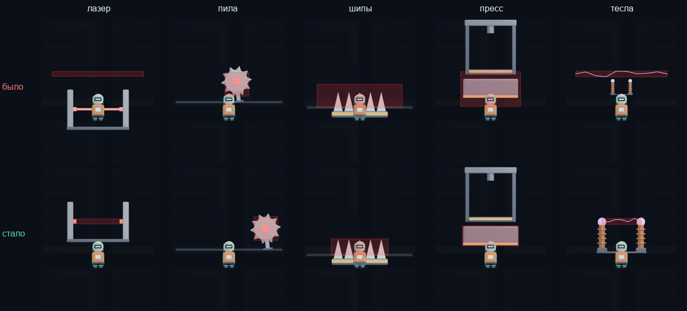
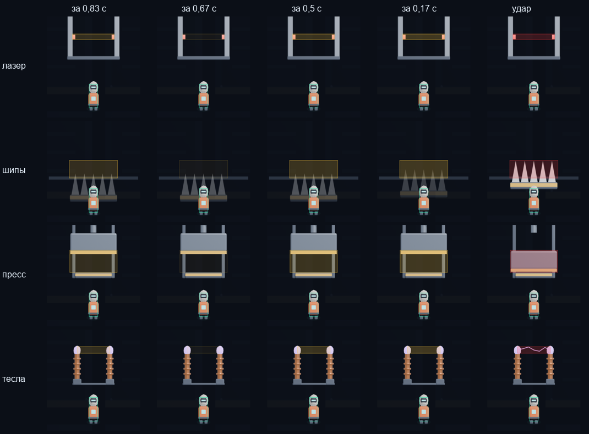

# Исправления 28.10.2026

Правки: Бабушкин Алексей. Основа — коммит `330fd38` от 15.10 («Retention: ежедневные миссии»).

Все баги ниже найдены запуском игры и тестов, а не чтением кода. Для каждого указано, как он
проявлялся, где исправлен и чем проверено. Пути к скриптам игры — от `game/Assets/Scripts/`.

## Итог

- 13 исправлений в игре (из них 2 — вход и лидерборд на настоящих Яндекс Играх, 1 — игра была
  непроходимой на старте даже для безошибочного игрока).
- Новое: экран «Настройки», чёткая картинка на больших экранах и телефонах, жёлтая зона-предупреждение
  за секунду до удара ловушек, ловушки сериями с гарантией проходимости, звуки жёлтой зоны, музыка.
- 4 исправления в тестах.
- 5 новых тестов: `check_pages.js`, `check_daily.js`, `sim_players.js` (без браузера), `probe_revive.js`
  и `shots_defense.js` (скриншоты); `audit_passability.js` переписан.
- Тесты теперь возвращают код ошибки, если что-то не так. Раньше часть из них печатала
  «ошибок нет» и при неработающей игре.
- Все 13 тестов проходят: `check_pages`, `check_daily`, `audit_passability`, `sim_players`, `cdp_test`,
  `probe_yandex`, `probe_pause`, `probe_missions`, `probe_playthrough`, `probe_minigames`,
  `probe_input`, `probe_scenes`, `probe_revive`.

## Ошибки, которые видел бы игрок или преподаватель

### 1. Страница с имитацией Яндекс Игр не запускалась (чёрный экран)

- **Как проявлялось:** `game/test-yandex.html` показывала чёрный экран. В консоли:
  `MissionService is not defined`. Сломано с 15.10: миссии добавили в `index.html`, а в
  `test-yandex.html` — нет. Это та страница, где видны вход, облако, лидерборд и покупки,
  то есть её и открыли бы на защите.
- **Почему тест не поймал:** ошибка возникала в асинхронном запуске (`Core/Boot.js`), а игра
  собирала только обычные ошибки. `probe_yandex.js` вызывал сервисы напрямую и писал
  «ERRORS: []», хотя игра не стартовала.
- **Исправлено:**
  - `game/test-yandex.html:31`, `:45` — подключены `MissionService.js` и `MissionsScene.js`.
  - `Core/Boot.js:12` — ошибки асинхронного кода (`unhandledrejection`) тоже попадают в `window.__ERRORS`.
  - `test/probe_yandex.js:41` — тест сначала проверяет, что игра запустилась, иначе `FAIL`.
- **Проверка:** новый `test/check_pages.js` сравнивает списки скриптов двух страниц.
  На старой версии: `FAIL ... нет MissionService.js, MissionsScene.js`; сейчас `ALL PASS`.

### 2. На настоящих Яндекс Играх не работали бы вход и лидерборд

Найдено сверкой кода с документацией Яндекса (yandex.ru/dev/games/doc, разделы «Лидерборды» и
«Данные игрока»), а не запуском: настоящий SDK работает только внутри Яндекс Игр.

- **Лидерборд.** Код вызывал `ysdk.leaderboards()` как функцию. В текущем SDK `ysdk.leaderboards` —
  объект с методами `setScore` и `getEntries`, а `getLeaderboards()` помечен устаревшим. Вызов падал,
  ошибка проглатывалась, лидерборд оставался выключен: результаты не отправлялись, таблица не показывалась.
- **Вход.** Игрок считался вошедшим, если у него есть `player.signature`. Это поле приходит, только если
  запросить игрока с `{ signed: true }`, а игра так не делает. Значит, любой игрок, даже вошедший в
  аккаунт Яндекса, считался гостем: кнопка «Войти» не пропадала, имя не показывалось. По документации
  проверять нужно `player.isAuthorized()`.
- **Почему тесты не ловили:** имитация SDK (`game/test/mock-yandex.js`) была написана под тот же
  неправильный код: `leaderboards` в ней — функция, у игрока есть `signature`.
- **Исправлено:** `YandexSDK/YandexSDK.js:20` — берётся объект `ysdk.leaderboards`
  (`setScore`/`getEntries`), старый способ — только если нового нет; `YandexSDK/YandexSDK.js:76` — вход через
  `isAuthorized()`, запасной путь — устаревший `getMode()`. Имитация SDK переписана по документации.
- **Проверка:** `probe_yandex.js` — лидерборд подключён, вошедший и гость различаются. С новой имитацией
  и старым кодом этот тест падает (`lb: false, authorized: false`), с исправленным — `ALL PASS`.
  На настоящей платформе не проверено: для этого игру нужно загрузить в консоль Яндекс Игр.

### 3. Ежедневная награда и миссии сбрасывались не в полночь

- **Как проявлялось:** день считался по Гринвичу (`toISOString()`), а таймер в сцене «Миссии»
  считает до местной полуночи. В Екатеринбурге день менялся в 05:00, в Москве в 03:00.
  Ночью таймер доходил до нуля, а миссии оставались вчерашними; серия входов считалась по чужим суткам.
- **Исправлено:** `Services/DailyService.js:10` — дата по местному времени игрока. Миссии берут дату
  отсюда же, так что исправились и они.
- **Проверка:** новый `test/check_daily.js` (часовой пояс Екатеринбурга задан внутри теста):
  00:30 28.10 — уже 28.10, день меняется ровно там, где кончается таймер, «вчера» через границу
  месяца и года. На старом коде 7 проверок из 13 падают.
- **Побочный эффект:** у игрока, который забрал награду между полуночью и 05:00 до обновления,
  один раз может появиться лишняя награда. Это разовый случай.

### 4. Две миссии из трёх иногда считали одно и то же

- **Как проявлялось:** миссии дня выбирались из пула без учёта счётчика. Примерно в 14% дней
  (51 из 365, посчитано на годе вперёд) выпадали, например, «пройди 30 этажей» и «пройди 60 этажей»:
  одно действие засчитывается в обе. Фактически миссий меньше трёх, а минимум курса — 3.
- **Исправлено:** `Services/MissionService.js:27` — после выбора миссии из пула убираются миссии с тем же счётчиком.
  Выбор по дате остался детерминированным: на всех устройствах игрока миссии одинаковые.
- **Проверка:** `test/check_daily.js` — 730 дней: всегда 3 миссии, нет общих счётчиков, каждая
  из 11 миссий выпадает. `probe_missions.js` — `ALL PASS`.

### 5. На старте обучения все пять надписей «НОВАЯ УГРОЗА» всплывали разом

- **Как проявлялось:** этажи создаются заранее, а надпись о новой ловушке показывалась при
  создании этажа. На первом экране обучения — пять надписей стопкой поверх подсказки «Лазер впереди».
- **Исправлено:** `Gameplay/GameScene.js:144`, `:266` — надпись показывается, когда этаж с ловушкой
  въезжает в кадр (`showTrapIntros`).
- **Проверка:** скриншот `docs/defense/02_tutorial.png` — одна надпись про лазер.

### 6. Длинные всплывающие сообщения обрезались по краям экрана

- **Как проявлялось:** «🎯 МИССИЯ ВЫПОЛНЕНА: … — награда в меню» шире экрана в 480 точек:
  видно было «ИССИЯ ВЫПОЛНЕНА: СМЕНЫ — награда в м». Это и есть пункт «интеграция с геймплеем»,
  который показывают на защите. Кроме того, сообщения ставились друг над другом с шагом 50 точек
  и наезжали друг на друга, если одно было в две строки.
- **Исправлено:** `UI/Hud.js:38` — перенос строк по ширине экрана; новое сообщение встаёт над
  верхним краем уже показанных с учётом их высоты.
- **Проверка:** скриншот `docs/defense/06_mission_toast.png`; проверен случай из трёх сообщений подряд.

### 7. Экран «Игра окончена»: блоки закрывали статистику

- **Как проявлялось:** блоки «Достижения» и «Миссии» ставились с шагом 95 точек, независимо от
  высоты. Если за забег открылось 4 достижения, блок закрывал строку «ИДЕАЛЬНЫХ» и «награда: +N монет».
- **Исправлено:** `UI/GameOverScene.js:28`–`61` — статистика в две строки, каждый блок встаёт под
  предыдущий по его настоящей высоте, кнопки всегда под блоками и над нижней строкой.
- **Проверка:** скриншот `docs/defense/07_gameover.png`; отдельно проверены случаи «все 7 достижений
  и 3 миссии», «2 достижения и 1 миссия», «ничего».

### 8. Лидерборд: «Ты: null место», своя строка не выделялась

- **Как проявлялось:** код проверял `userRank !== undefined`. По документации Яндекс SDK `userRank` равен 0,
  если игрока нет в таблице, — выводилось «Ты: 0 место» (в имитации SDK — «null место»). Свою строку
  искали по полю `isCurrentUser`, которого у записей SDK нет, поэтому стрелка «→» не появлялась никогда.
- **Исправлено:** `Services/LeaderboardService.js:21` — ранг 0 означает «нет в таблице»; своя строка
  ищется по рангу. В имитации SDK (`game/test/mock-yandex.js:32`) `userRank` теперь тоже 0, как в настоящем.
- **Проверка:** `probe_yandex.js`: до первого результата строки «Ты: …» нет, после — «2 место»
  и стрелка на своей строке. Скриншот `docs/defense/11_leaderboard.png`.

### 9. Экран приветствия: заголовок наезжал на текст; вошедшему игроку предлагали войти

- **Как проявлялось:** «ХРОНОЛИФТ» перекрывал первые строки истории. На странице с имитацией SDK
  (и в Яндекс Играх у вошедшего игрока) всё равно была кнопка «Войти через Яндекс».
- **Исправлено:** `UI/MenuScene.js:113` — заголовок выше, текст идёт от него вниз;
  `UI/MenuScene.js:130` — если игрок уже вошёл, кнопка называется «ИГРАТЬ», ссылки «играть без входа» нет.
- **Проверка:** скриншот `docs/defense/01_welcome.png` и проверка вручную на `test-yandex.html`.

### 10. После смерти не нажималась ни одна кнопка предложения возродиться

- **Как проявлялось:** после смерти появляется окно «ХРОНОСБОЙ!» с тремя кнопками: возродиться за рекламу,
  за 100 монет или «отказаться». Ни одна не реагировала на нажатие, игрок застревал. Так было и в исходной
  версии от 15.10 (проверено тем же тестом), просто автотесты этого окна не нажимали: в режиме автопилота
  возрождение срабатывает само.
- **Причина:** окно закреплено на экране (`setScrollFactor(0)` у контейнера), а кнопки внутри — нет.
  Phaser проверяет нажатие по закреплению самой кнопки, поэтому область нажатия уезжала вместе с камерой
  забега, хотя нарисованы кнопки были на месте. Штатный `setScrollFactor(0, 0, true)` у контейнера
  в этой сборке Phaser до кнопок не доходит — проверено.
- **Исправлено:** `Gameplay/GameScene.js:471` — закрепление ставится каждой кнопке окна.
- **Проверка:** новый `test/probe_revive.js`: настоящая смерть на ловушке, затем нажатие мышью каждой кнопки —
  «отказаться» ведёт на экран итогов, «за монеты» списывает 100 монет и продолжает забег, «реклама» показывает
  рекламу (в имитации SDK) и продолжает забег. Проходит при масштабе 1 и 2,75; на исходной версии падает.

### 11. Красные зоны ловушек не совпадали с картинками

- **Как проявлялось:** красная зона — это место, где игрок умирает, но стояла она не там, где нарисована
  ловушка. Зоны и картинки были расставлены в коде отдельными числами и не сверялись.
  - **Лазер:** опасный луч проходил на 150 точек выше нарисованного лазера, в пустоте. На самой картинке луч
    был нарисован постоянно, хотя опасен он примерно 1 секунду из 2,8.
  - **Тесла:** катушки уменьшены до 0,45 и стояли в центре, а разряд шёл через всю шахту, выше контактов.
  - **Шипы:** зона на 31 точку выше остриёв и в полтора раза шире шипов — смерть без касания.
  - **Пресс:** зона на 35 точек ниже плиты — смерть под прессом без касания. Кроме того, рама стояла
    на 126 точек выше хода плиты: при ударе плита пробивала нижнюю опору рамы и ложилась под ней,
    а поднятая плита закрывала весь верх рамы.
  - **Пила:** зона смещена на 14 точек вниз от центра диска.
- **Исправлено** (`Gameplay/Traps.js`, `Art/Sprites/trap_laser.png`):
  - лазер и тесла (`LaserTrap`, `TeslaTrap`) — картинки поставлены к опасным линиям: луч идёт между
    излучателями, разряд — между шарами-контактами; с картинки лазера стёрт вшитый луч, теперь он виден
    только при предупреждении и выстреле. Высота зон не менялась;
  - шипы (`SpikesTrap.rects`) — зона от остриёв до пола по ширине шипов и движется вместе с ними;
    спрятанные шипы теперь полупрозрачные: они всё равно торчат над полом, и было непонятно, опасны ли они;
  - пресс (`CrusherTrap`) — рама собрана: поднятая плита висит под поршнем, при ударе ложится на нижнюю
    опору. Где плита лежит после удара, не менялось. Зона — по самой плите, в том числе во время удара,
    но не выше 160 точек над полом, как в исходном балансе: лифт проходит сквозь раму;
  - пила (`SawTrap.rects`) — зона по центру диска.
- **Сложность:** шипы и пресс стали немного мягче, потому что зона меньше и умереть можно только от касания.
  `test/audit_passability.js` пересчитан под новые размеры: в худшем месте запас энергии вырос
  с 45,5 до 59,1 из 100.
- **Проверка:** все пять ловушек сняты в момент опасности до и после (картинка выше). Все тесты проходят,
  бот в `probe_playthrough.js` доходит до 7–10 этажа и погибает от нехватки энергии, как и в исходной версии.
  `probe_missions.js` больше не зависит от того, умер ли автопилот за 30 секунд.

### 12. Опечатки

- `Core/Config.js:55` — миссия «НЕУЯВИМЫЙ» → «НЕУЯЗВИМЫЙ».
- `docs/GDD.md`, раздел 5.1 — в заголовке стояли китайские иероглифы «核心» → «(ядро игры)».

## Новое

### 13. Экран «Настройки»

В требованиях курса к минимальному меню есть «Настройки», в игре был только значок звука.

- `UI/SettingsScene.js` (новый) — звук; «Пройти обучение заново»; «Сбросить прогресс» с подтверждением
  вторым нажатием в течение 3 секунд. Покупки при сбросе сохраняются: это деньги игрока, и Яндекс
  всё равно вернул бы их через проверку покупок.
- `UI/MenuScene.js:46` — кнопка «НАСТРОЙКИ» под основными кнопками. Сцена добавлена в `Core/Boot.js:60`
  и в обе страницы.
- **Проверка:** `cdp_test.js` открывает настройки и возвращается в меню; сброс проверен вручную:
  монеты, рекорд и достижения обнулились, покупка «Тишина» осталась, миссии дня выданы заново.

«Выход» не добавлял: в браузерной игре выход — закрыть вкладку.

### 14. Чёткая картинка: отрисовка в разрешении экрана

- **Как проявлялось:** игра всегда рисовала картинку 480×800 точек, а браузер растягивал её на окно:
  на большом мониторе в 2 раза и больше, на телефоне с плотностью экрана 3 — примерно в 2,4 раза.
  Текст и края были мыльными.
- **Исправлено:**
  - `Core/Config.js:21` — `RENDER_SCALE`: во сколько раз холст больше мира 480×800. Считается по размеру
    экрана и окна с учётом плотности пикселей, шаг 0,25, от 1 до 3.
  - `Core/Boot.js` — холст создаётся размером `480·RENDER_SCALE × 800·RENDER_SCALE`.
  - `Core/Components.js:10` — `fitCamera(scene)`: камера увеличивает мир в `RENDER_SCALE` раз от левого
    верхнего угла. Вызывается первой строкой `create()` в каждой из 8 сцен. Координаты во всём остальном
    коде остались прежними (мир 480×800), нажатия Phaser пересчитывает сам.
  - `Core/Components.js:19` — весь текст рисуется с `resolution = RENDER_SCALE`, иначе он оставался бы
    мыльным и на большом холсте.
  - Картинки персонажей и ловушек — PNG по 256 точек, при сильном увеличении они немного мягче текста.
    Это предел самих картинок, а не отрисовки.
- **Заодно:** `UI/MissionsScene.js` — подпись «сброс в 21:19» показывала не время сброса, а сколько до него
  осталось (в 02:40 ночи — «сброс в 21:19»). Теперь «новые через 21 ч 19 мин».
- **Заодно:** `UI/MenuScene.js:188` — сообщение в меню «+25 монет! Возвращайся завтра · миссии ждут награды»
  не помещалось по ширине, теперь переносится.
- **Проверка:** все браузерные тесты принимают `CHRONO_DPR` (плотность экрана тестового браузера).
  `cdp_test.js` проверяет размер холста и увеличение камеры. При плотности 1, 2 и 3 (масштаб 1; 1,75; 2,75)
  проходят все тесты: клики по кнопкам всех экранов, удержание для остановки времени, мини-игры, бот проходит этажи.
  Вручную в браузере: меню, запуск забега, остановка времени.

### 15. Жёлтая зона-предупреждение за секунду до удара

- **Зачем:** ловушки, которые включаются по времени (лазер, шипы, пресс, тесла), убивают только в свою фазу.
  Раньше перед ударом было видно лишь слабое мигание самой ловушки, а куда она ударит — нет.
- **Сделано:** за 1 секунду до включения на месте будущей красной зоны появляется жёлтая и трижды
  вспыхивает, к концу ярче; в момент удара она становится красной. У пресса жёлтая зона — там, куда
  ляжет плита. Пила опасна всегда, у неё жёлтой зоны нет.
  - `Gameplay/Traps.js` — у четырёх ловушек методы `msToDanger()` (сколько осталось до удара)
    и `warnRects()` (где будет опасно);
  - `Gameplay/GameScene.js` — `drawHitboxes()` рисует жёлтую зону, длительность — `GameScene.WARN_MS = 1000`.
  - Позже рамки заменены предупреждениями самих ловушек — см. пункт 23.
- **Баланс не меняется:** тайминги ловушек те же, это только подсказка.
- **Проверка:** кадры каждой ловушки за 0,83 / 0,67 / 0,5 / 0,17 с до удара и в момент удара (картинка выше).

### 16. Игра была непроходимой на старте: ловушки сериями с гарантией

- **Как проявлялось:** ловушки шли подряд, по одной-две на этаж, без пауз. Остановка времени не пропускает
  опасность, а ставит её на паузу: если ловушка включилась, когда игрок в её зоне, держать приходится до выхода.
  На старте лифт медленный (95 px/с), и пилу или пресс приходится держать до 2 секунд — 50–66 энергии
  из 100, а за этаж восстанавливается меньше. Симуляция на настоящем коде ловушек, 200–300 забегов
  до 60-го этажа:
  - безошибочный игрок, зажимающий ровно когда иначе погиб бы, погибал в **20%** забегов, почти всегда
    до 20-го этажа;
  - с ошибкой 20% (тратит на 20% больше энергии) — в **61%**;
  - даже лучшая игра с предвидением (заранее сдвигает фазы ловушек) без ошибок погибала в 2 забегах из 200 —
    гарантированная смерть, с ошибкой 20% — в 45 из 200.
  Старый `audit_passability.js` при этом показывал «запас 59 энергии»: он считал упрощённо.
- **Попутно — двойной счёт этажей:** `onFloorPassed` вызывался на каждую ловушку, этаж с двумя ловушками
  считался за два — скорость росла быстрее, счёт и миссии завышались. Исправлено в `GameScene.floorPassedBy`.
- **Исправлено:** новый `Gameplay/FloorPlanner.js`. Ловушки идут сериями по 2–4 угрозы, после серии —
  передышка до полной энергии. **Гарантия по построению:** стратегия «держать заморозку всё время в опасной
  зоне» проходит любую ловушку при любой фазе, идеальная игра тратит не больше. Генератор ставит ловушку,
  только если эта стратегия с ошибкой 20% — держит на 20% дольше, причём лишнее время может прийтись на
  свободный ход, где игрок недополучит восстановление, — не опустит энергию ниже 2 (порог включения заморозки).
  Не помещается — серия заканчивается раньше, передышка считается так, чтобы энергия восстановилась до 100.
  Зоны ловушек — `TRAP_SPANS` в `Gameplay/Traps.js`.
- **Как теперь выглядит:** на этажах 1–10 в среднем 2,8 угрозы в серии и передышка ~500 px (≈4 с),
  дальше 3 угрозы и ~600 px (2–3 с). Серии из одной угрозы — 0,2%: когда энергии хватает только на одну
  тяжёлую ловушку.
- **Проверка:**
  - `test/audit_passability.js` (переписан): зоны `TRAP_SPANS` совпадают с `rects()` ловушек во всех фазах;
    на 2000 шахт × 300 этажей худший запас у игрока «держит всю зону и ошибается на 20%» — ровно 2.0;
    серий длиннее 4 угроз нет;
  - `test/sim_players.js` (новый): 300 забегов до 60-го этажа на настоящем коде — 0 смертей у безошибочного
    игрока, у тратящего на 20% больше и у отпускающего на 20% позже. Оба промаха сразу (+44%, вне гарантии) —
    8 из 300 вместо прежних 89%.
- **Автопилот самопроверки** (`GameScene.autoHold`, `?autotest=1`) держал заморозку при любой опасной ловушке
  в 300 px и тратил энергию впустую; его выручал двойной счёт этажей, разгонявший лифт. Теперь держит, только
  если в ближайшие кадры коснётся красной зоны или жёлтой, которой до включения меньше 60 мс; проходит все
  30 секунд самопроверки без смерти (~110 этажей).

### 17. Звуки жёлтой зоны и громкость ловушек по расстоянию

- **Жёлтая зона** — три сигнала в такт вспышкам, каждый выше предыдущего; у каждой ловушки свой тембр
  (`Sfx.warn`): лазер — писк, тесла — жужжание с подъёмом, шипы — стук, пресс — низкий удар с призвуком.
- **Громкость по расстоянию** (`GameScene.trapGain`): впереди нарастает по мере приближения (слышно
  примерно за полтора этажа), позади — тише и быстрее затухает. Так же теперь звучат и сами ловушки:
  раньше включение лазера или удар пресса было слышно на полную громкость за 8 этажей вперёд, где ловушку
  ещё не видно.
- **Проверка:** в браузере сигналы звучат, громкость растёт при приближении (0,30 → 0,38 → 0,47 за одну зону).

### 18. Музыка

- Меню и экраны из меню — «13. I am not clumsy», забеги — «02. Perilous Dungeon», «03. Boss Battle»,
  «04. Mechanical Complex» по очереди (каждый новый забег — следующий). Всё зациклено.
  Автор — HydroGene, лицензия CC0 (`Assets/Audio/Music/CREDITS.md`).
- Файлы перекодированы: 16,7 МБ → 5 МБ на скачивание (`.ogg` без шва на петле + `.mp3` для Safari).
  Все треки грузятся по одному в фоне (сначала трек меню) отдельной сценой `MusicLoader`, которая работает
  всю игру: старт игры музыку не ждёт. Пока трек забега не загрузился, продолжает играть прежний, без тишины
  (проверено на сети 2 Мбит/с: трек забега включается через ~6 с).
- `Core/Music.js`; в настройках — отдельный переключатель «МУЗЫКА», значок ♪ в меню выключает всё.
  На время рекламы музыка на паузе (требование Яндекс Игр), на паузе платформы — тоже.
- **Проверка:** в браузере — смена треков меню → забег 1 → 2 → 3 → 1, выключение и пауза на рекламу.

### 19. Игра одним файлом для запуска без интернета

- **Зачем:** защита на паре, интернет там может быть плохим. `game/index.html` двойным щелчком не работает:
  браузер не даёт странице, открытой как файл, загружать картинки, данные и музыку.
- **Сделано:** `tools/build_offline.js` собирает `chronolift-offline.html` в корне репозитория (8,5 МБ):
  все скрипты, картинки, данные ловушек и музыка (.ogg) внутри. При запуске ассеты превращаются
  в `blob:`-адреса и подставляются загрузчику Phaser вместо путей `Assets/...`. Основа — `test-yandex.html`
  с имитацией Яндекс SDK; настоящий SDK с yandex.ru не подключается, чтобы страница не ждала сеть.
- **Проверка:** файл открыт как `file://` в Chrome с полностью отключённой сетью — меню за 0,7 с,
  картинки, ловушки, музыка (меню и забег), забег, смерть, отказ от возрождения, экран итогов; запросов
  в интернет 0, ошибок 0. `test/check_offline.js` — сборка соответствует текущей игре и не грузит ничего
  из сети; если игру изменили, а файл не пересобрали, тест падает с подсказкой.

### 20. Волна при остановке времени

- При остановке времени от персонажа расходится кольцо: пиксели под ним инвертируются (негатив, как
  фильтр — только по периметру волны) и слегка преломляются, как в линзе; за 1,1 с кольцо целиком
  уходит за края экрана и только там гаснет.
- Волна не зависит от того, держит ли игрок палец: отпустил сразу — она всё равно доходит до края.
  Новое нажатие запускает ещё одну волну, а не обрывает прежнюю (одновременно до 4).
  Раньше каждое нажатие начинало волну заново, и при частых коротких нажатиях она пропадала на полпути.
- `Gameplay/Shockwave.js` — шейдер постобработки камеры (WebGL), подключается только пока есть волны;
  запуск — `GameScene.setFrozen`. При системной настройке «уменьшить движение» волны нет.
- **Проверка:** `test/probe_wave.js` — нажатие на 80 мс: волна идёт после отпускания, через 0,6 с
  у верхнего края, к 0,95 с ушла за экран; два нажатия подряд — на экране две волны. Снимки `test/wave_*.png`.

### 21. Реклама за награду и магазин — только после входа

- **Требование преподавателя** (пара 17.09, запись 57:30): часть функций доступна только после
  авторизации — реклама за вознаграждение (гостю Яндекс её не засчитает) и магазин.
- **Было:** проверки не было; вне Яндекс Игр запасной режим разработки к тому же «выдавал» покупки
  и награду за рекламу бесплатно.
- **Сделано:** `requireAuth` в `Core/Components.js` — гостю окно «Нужен вход» с кнопкой «Войти через
  Яндекс»; после входа действие продолжается. Подключено к «Купить» и «Восстановить покупки»
  (`UI/ShopScene.js`), возрождению за рекламу (`GameScene.showReviveOffer`) и «×2 монеты»
  (`UI/GameOverScene.js`). Если реклама не досмотрена или недоступна — сообщение под кнопкой;
  если вход не удался — сообщение в окне и в меню.
- **Проверка:** в имитации SDK гость нажимает «Купить» → окно входа → вход → покупка прошла.
  На показе ничего не меняется: в имитации игрок уже вошёл.

### 22. Кнопки главного меню налезали друг на друга

- **Было:** кнопки «Миссии», «Скины», «Магазин», «Достижения» шириной 250 px стояли с шагом 220 px —
  соседние перекрывались на 30 px, рамки сливались в одну полосу.
- **Сделано:** `UI/MenuScene.js` — ширина 206 px, между кнопками 20 px; красный значок миссий
  перенесён в угол новой кнопки.
- **Проверка:** скриншот меню.

### 23. Опасность без отладочных рамок, коллайдер по спрайту, лифт с часами

- **Было:** вокруг персонажа — бирюзовая рамка, вокруг ловушек — красные и жёлтые прямоугольники,
  как зоны столкновений в редакторе. Луч лазера при этом не был виден вообще: прямоугольники луча
  создавались с нулевой заливкой, опасность показывала только рамка. Персонаж висел в пустоте,
  хотя игра про лифт.
- **Сделано:**
  - Рамок нет. Опасность показывают сами ловушки, по одному правилу: жёлтое мигает — скоро ударит
    (за 1 с, три вспышки в такт звуку), красное — опасно сейчас. `Gameplay/Traps.js`, `trapWarnK`, `trapBlink`:
    - лазер — прицельный луч растёт от излучателей к центру и смыкается в момент выстрела, затем красный луч;
    - тесла — контакты разгораются, по линии будущей дуги пунктир, навстречу бегут искры; дуга со свечением;
    - шипы — неопасные полупрозрачные (18%), за секунду до удара мигают и становятся плотными;
    - пресс — на опоре сгущается тень и мигает жёлтая кромка, плита дрожит; в ударе плита красноватая;
    - пила — без меток, опасна всегда.
  - Рамки остались как режим: «Настройки» → «Зоны ловушек» (по умолчанию выключено, `GameScene.drawZones`).
  - Коллайдер персонажа — по непрозрачным пикселям спрайта (`GameScene.buildPlayerMask`, `playerHits`):
    для каждой строки силуэта левый и правый край. Спрайт масштабируется так, чтобы силуэт был 94 px
    в высоту — на этот рост рассчитана гарантия проходимости, поэтому персонаж стал чуть меньше
    (масштаб 0,435 вместо 0,54). Новый спрайт персонажа подстроится сам.
  - Пила сталкивается по кругу радиусом 52 px (`SawTrap.hitShapes`), а не по квадрату: угол квадрата
    больше не убивает. Планировщик считает по квадрату — с запасом.
  - Лифт: плита со срезанными нижними углами и часы под ней (`Gameplay/LiftPlatform.js`,
    картинку рисует `tools/make_lift_sprite.py`). Стрелки идут (оборот за 1,5 с) и стоят, пока время
    остановлено. В меню герой тоже стоит на лифте.
- **Проверка:** `test/probe_traps_look.js` — снимки каждой ловушки «скоро ударит» и «опасно»,
  высота коллайдера 94 px, пила по кругу. `audit_passability.js` и `sim_players.js` — 0 смертей, как раньше.

## Тесты

- `test/cdp_test.js:79` — итог автопилота пишется через ~31,5 с после загрузки, а тест читал его на
  18-й секунде, поэтому всегда выводил `TESTLOG: null`. Теперь ждёт до 20 секунд сверх этого.
  Тест возвращает код ошибки, если итога нет, есть ошибки или не открылись настройки.
- `test/probe_yandex.js` (раздел 6) — проверка паузы читала несуществующее свойство `loop.sleeping`
  и выводила `undefined`. Теперь `loop.running`.
- `test/probe_missions.js:92`, `:183` — тест сам считал «сегодня» по Гринвичу, то есть повторял ошибку
  из пункта 3. Ночью он падал на исправленной игре. Теперь местная дата.
- `test/probe_missions.js` — тест иногда падал сам по себе: если автопилот за 30 секунд ни разу не умер,
  попытка завершить забег тратила возрождение вместо конца забега, и счётчики миссий не сохранялись.
  Теперь забег завершается гарантированно.
- `test/shots_defense.js` (новый) — снимает 12 скриншотов для `docs/DEFENSE.md`: автопилот играет
  забег, потом скрипт обходит экраны и проверяет, что после перезагрузки прогресс тот же.

## Документация

- `docs/DEFENSE.md` (новый) — памятка к защите: подготовка, сценарий на 2–3 минуты по пунктам
  рубрики, где что в коде, ответы на вопросы.
- `docs/RETENTION.md` — день по местному времени вместо UTC; миссии дня с разными счётчиками.
- `README.md` — настройки, новые документы, как запускать тесты (сервер на порту 8321).

## Заметил, но не трогал

- **Цены в магазине записаны текстом «99 ₽»** (`PRODUCTS` в `Core/Config.js`). В Яндекс Играх
  цены покупок задаются в консоли разработчика и приходят из SDK (`payments.getCatalog()`),
  код валюты тоже приходит оттуда (`priceCurrencyCode`). Перед публикацией цены стоит брать из каталога.
  На настоящем кабинете не проверял.
- **Игра на Phaser 3, курс про Unity.** Нужно уточнить у преподавателя, засчитывается ли.
- `test/debug_clicks.js` — отладочный скрипт, подписи кликов не совпадают с кнопками (клик по «Миссиям»
  подписан как «скины»). В набор тестов не входит, не трогал.
